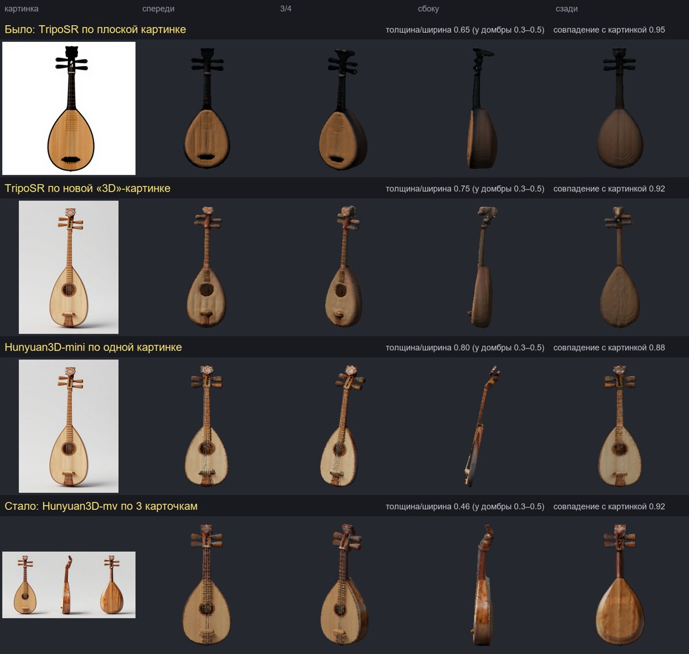
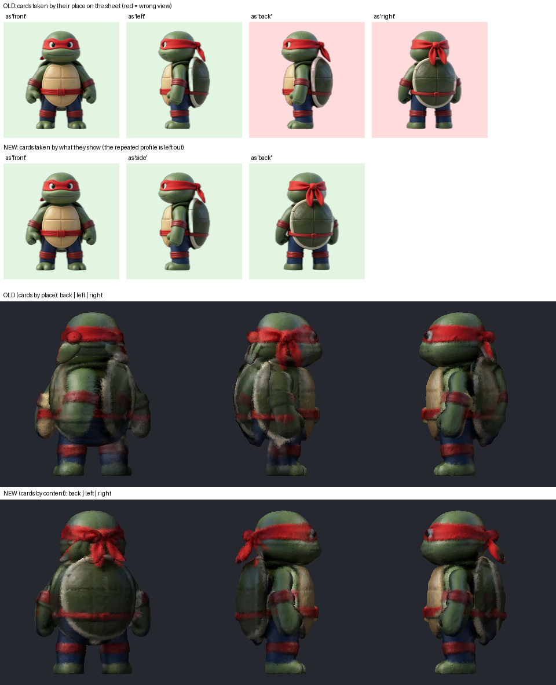
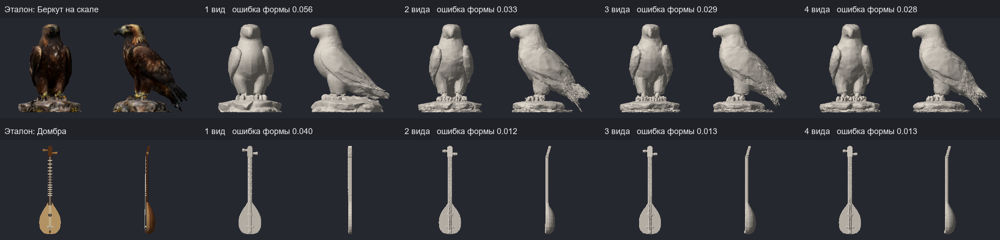

# Замеры

Компьютер: **NVIDIA GeForce RTX 3050, 8 ГБ** (драйвер 591.86, CUDA 13.1), AMD Ryzen 5 8400F, 32 ГБ DDR5,
Windows 11 Pro, PyTorch 2.14.1+cu130, diffusers 0.40.0, transformers 5.18.0. Во время замеров были открыты
Blender 5.2, Chrome, Skybrush и др.: до начала задачи они занимали ~1 ГБ видеопамяти (свободно ~7 ГБ).
EasyDiffusion не работал.

Как мерить у себя: `runtime\venv\Scripts\python -m dronegen_server.bench …` (см. `--help`). Каждая строка
пишется в `runtime\logs\bench.jsonl`.

* **загрузка** — первая загрузка модели в процесс сервера (диск → RAM/VRAM);
* **задача** — от начала задачи до готового файла, без загрузки модели;
* **VRAM** — пик выделенного PyTorch (`max_memory_reserved`); видеопамять всего устройства в пике была выше
  на ~1–2 ГБ (другие программы, контекст CUDA);
* **RAM** — пик private bytes процесса сервера (то, что считается в лимит выделения Windows).

## Картинки (txt2img)

### Z-Image-Turbo — GGUF Q4_K_M, энкодер Qwen3-4B на CPU, 9 шагов, без CFG

| Размер | Режим памяти | Загрузка, с | Задача: новый промпт, с | Задача: тот же промпт, с | VRAM, ГБ | RAM, ГБ |
|---|---|---|---|---|---|---|
| 512² | обычный | 17,8 | 26,0 | — | 5,34 | 14,5 |
| **768²** | **обычный** | 15,4 | 36,2 | **28,4** | **5,56** | 14,5 |
| 1024² | обычный | 17,9 | 58,1 | — | 5,81 | 14,5 |
| 768² | экономный (group) | 20,5 | 39,8 | — | 2,54 | 16,6 |
| 1024² | экономный (group) | 18,8 | 58,2 | 47,5 | 4,87 | 16,6 |

* «Новый промпт» включает загрузку текстового энкодера с диска (3–5 с) и кодирование на CPU (<1 с);
  энкодер после этого выгружается, эмбеддинги промпта кешируются — новые seed того же промпта его не ждут.
* Денойзинг: ~1,8 с/шаг при 512², ~3 с/шаг при 768², ~5 с/шаг при 1024².
* RAM в покое (модель загружена, задач нет) ~9 ГБ; пик 14,5 ГБ — на загрузке энкодера и когда трансформер
  возвращается из видеопамяти на CPU. С `"zimage_keep_text_encoder": true` в `runtime\config.json` энкодер
  остаётся в памяти: новый промпт быстрее на 3–5 с, RAM +8 ГБ.
* Режим выбирается сам: «обычный», если свободно ≥ 6,5 ГБ VRAM, иначе «экономный»: слои подгружаются по
  одному параллельно с вычислениями — ~10 % медленнее, VRAM вдвое меньше на 768². Если видеопамяти
  всё равно не хватит — «минимальный» (sequential offload).
* Почему не bf16: transformer в репозитории хранится в fp32 (24,6 ГБ), в bf16 ему нужно ~12 ГБ VRAM.

### SDXL base 1.0 — fp16, VAE fp16-fix, 25 шагов, CFG 6

| Размер | Режим | Загрузка, с | Задача, с | VRAM, ГБ | RAM, ГБ |
|---|---|---|---|---|---|
| 768² | обычный | 10,3 | 18,5 | 5,42 | 15,6 |
| 1024² | обычный | 13,2 | 33,4 | 5,63 | 15,8 |

SDXL быстрее, но хуже держит промпт: без негативного промпта рисует рамки и фон. В аддоне для SDXL
по умолчанию стоит негативный промпт против рамок, фона и текста.

## 3D (img2mesh)

### TripoSR — `examples/horse.png`, фон убирает rembg на CPU (входит во время задачи)

| mc_resolution | chunk_size | Загрузка, с | Задача, с | VRAM, ГБ | Треугольников |
|---|---|---|---|---|---|
| 128 | 8192 | 12,1 | 1,6 | 1,98 | 21 396 |
| 192 | 8192 | 11,6 | 2,4 | 2,29 | 50 708 |
| **256** | **8192** | 11,7 | **3,7–4,0** | **2,95** | 89 904 |
| 256 | 2048 | 12,0 | 6,7 | 2,95 | 89 904 |
| 256 | 0 (без разбиения) | 11,9 | 24,0 | 18,6 ⚠ | 89 904 |

* Пик VRAM почти не зависит от `chunk_size` при 2048–8192: его определяют веса и сетка marching cubes.
* `chunk_size=0` просит 18,6 ГБ — на Windows это не ошибка, а уход в общую память: в 6 раз медленнее.
  Поэтому разбиение всегда включено (по умолчанию 8192), при нехватке памяти сервер сам повторяет задачу
  с 2048 и разрешением 192, потом на процессоре.
* Marching cubes — PyMCubes вместо torchmcubes, на CPU: 0,26 с на сетке 256³ (scikit-image — 0,31 с).

### Точность формы: TripoSR, Hunyuan3D-2mini, Hunyuan3D-2mv

**Известный объект.** Несимметричная фигура из цветных брусков: корпус, «нос» спереди (+Z), «рука»
справа (+X), «труба» сзади, «нога». Её рисует программный рендер с нужных сторон, и эти картинки
подаются моделям. Ошибка — расстояние Чамфера между результатом и оригиналом (оба приведены к размеру 1):

| Способ | Карточки | Ошибка формы |
|---|---|---|
| TripoSR | спереди | 0,105 |
| Hunyuan3D-2mini | спереди | 0,089 |
| Hunyuan3D-2mv | спереди | 0,094 |
| Hunyuan3D-2mv | спереди + «left» = вид с +X | **0,026** |
| Hunyuan3D-2mv | спереди + «right» = вид с −X | 0,033 |
| Hunyuan3D-2mv | спереди + «left» = вид с −X (не та сторона) | 0,087 |
| Hunyuan3D-2mv | все 4 вида | 0,027 |

* Одна картинка не говорит, что спереди и что сзади: «нос» не восстанавливает ни одна модель. Боковая
  карточка уменьшает ошибку в **3,4 раза**.
* Названия видов у Hunyuan3D-2mv: «left» — левый бок самого объекта, то есть вид с +X (`cards.CAMERA`).
  Вывод модели уже в осях glTF.
* Если неизвестно, с какой стороны снят бок (лист видов), сервер пробует оба варианта и берёт тот, где
  форма лучше совпадает со всеми карточками: 0,94 против 0,78 (2 карточки) и 0,91 против 0,46 (3 карточки).
  По одним силуэтам вариант не отличить от зеркального по глубине, решают светотень и цвета картинки:
  на сером объекте без светотени выбор ошибался. Поэтому при отрыве меньше 0,05 сервер предупреждает.
  Проверка — `test_gpu_backends.py::test_hunyuan_side_card_makes_the_shape_exact`.

**Домбра.** Картинки Z-Image в стиле «объёмный рендер» и лист видов 1536×768 (спереди | сбоку | сзади), seed 11 и 22:

| Способ, картинка | Толщина / ширина | Силуэт спереди | Задача, с | VRAM, ГБ | Треугольников |
|---|---|---|---|---|---|
| было: TripoSR, плоская картинка | 0,65 | 0,93 | ~4 | 2,95 | 38 556 |
| TripoSR, объёмный рендер спереди | 0,75 | 0,92 | 4,4 | 2,95 | 25 468 |
| Hunyuan3D-2mini, объёмный рендер спереди | 0,80 | 0,80 | 8,9 | 4,74 | 180 616 |
| Hunyuan3D-2mini, рендер 3/4 | 1,12 | 0,70 | 9,1 | 4,74 | 230 372 |
| **Hunyuan3D-2mv, лист видов (seed 11)** | **0,46** | 0,89 | 22,5 | 5,87 | 248 108 |
| **Hunyuan3D-2mv, лист видов (seed 22)** | **0,48** | 0,91 | 22,4 | 5,87 | 239 308 |
| то же + симметрия + «гладко» | 0,46 | 0,87 | 21,8 | 5,87 | 69 844 |

* У настоящей домбры толщина корпуса 0,3–0,5 ширины: такую даёт только Hunyuan3D-2mv с карточками. По одной
  картинке получается «яйцо» (TripoSR) или наклонённая доска (Hunyuan3D-2mini).
* «Силуэт спереди» (IoU с вырезанной картинкой, с учётом пропорций) у TripoSR высокий: он «выдавливает»
  картинку. Глубину эта метрика не видит.
* Hunyuan3D-2mv: 22 с, из них ~12 с — автоопределение стороны боковой карточки (2 пробных прогона). С
  известной стороной (`side: left`) — ~10 с. Загрузка 26 с, пик видеопамяти устройства 7,8 ГБ из 8.
* Картинка по-прежнему похожа на китайскую пипу (4 колка вместо 2): это ошибка картинки, а не 3D.
  Её исправляют база знаний, проверка художником и фото-референсы.

### Силуэт → объём — CPU, без нейросети; картинка беркута 768² от Z-Image

| mc_resolution | Удаление фона | Задача, с | RAM, ГБ | Треугольников |
|---|---|---|---|---|
| 128 | rembg | 3,8 | 2,6 | 40 652 |
| 192 | rembg | 3,9 | 2,6 | 95 992 |
| 256 | rembg | 4,4 | 2,7 | 174 560 |
| 192 | простой (по цвету фона) | 1,9 | 1,9 | 95 764 |

Сетка всегда замкнутая. Около 2 с из времени — rembg (U²-Net на процессоре).

## Вся цепочка в Blender

Сквозной тест в headless Blender 5.2.1 (`tests\run_blender_e2e.py --real`): пресет «Беркут» → Z-Image 768² →
TripoSR → меш в коллекции DroneGen:

| Шаг | Время |
|---|---|
| Z-Image, первая картинка (с загрузкой модели) | 59 с |
| TripoSR (с загрузкой модели, Z-Image при этом выгружается) | 9 с |
| Повторная картинка того же промпта / новый 3D | ~28 с / ~4 с |

Самопроверка `selfcheck --offline --models` (сеть запрещена) загружает и запускает все модели: SDXL,
TripoSR, Z-Image, rembg, силуэт.

## Студия: чат, чертежи, арт-директор

RTX 3050 8 ГБ. Локальная модель чата — Qwen3-VL-8B Q4_K_M (llama.cpp, CUDA 12.4).

| Что | Результат |
|---|---|
| Запуск локальной модели чата | ~10 с, ~6 ГБ видеопамяти |
| Скорость ответа | ~24 токена/с |
| Бриф (промпт-инженер) | ~25 с |
| Лист видов Z-Image 1536×768 | ~60 с на вариант |
| Точный чертёж (домбра, шанырак, юрта, Байтерек) | 10–40 мс (домбра: 3432 треугольника, замкнутая) |
| Диалог «домбра → картинки на выбор» целиком | ~3 мин (186 с) |
| Диалог «домбра → точная модель» | ~1,5 мин |

### Арт-директор: считает ли модель колки на картинке

Восемь картинок с четырьмя колками и два рендера с двумя (число колков известно заранее). Сравнение трёх способов
спросить локальную модель:

| Способ | 4 колка, верно | 2 колка, верно |
|---|---|---|
| вся картинка | 5 из 8 | 2 из 2 |
| только головка | 7 из 8 | 1 из 2 |
| головка + вид сбоку | 7 из 8 | 2 из 2 |

Ложное «всё верно» для картинки с четырьмя колками при согласии всех способов: 0 из 8 (при проверке по минимуму —
3 из 8). Поэтому арт-директор сверяет все способы, а ошибка в сторону «забраковать лишнее» считается допустимой.

### Эксперимент: можно ли заставить Z-Image нарисовать домбру с двумя колками

Два промпта, по 4 картинки (seed 101–104), проверка тем же арт-директором:

| Промпт | Прошло проверку |
|---|---|
| A: «два колка» в обычном описании | 0 из 4 |
| B: усиленное описание («ровно два колка, по одному с каждой стороны») | 2 из 4 |

Z-Image рисует домбру как пипу с четырьмя колками независимо от слов, а проверка пропускает лишь половину удачных.
Вывод: для предметов с известной формой надёжнее **точный чертёж**, а нейросетевая картинка — для всего остального.

### Hunyuan3D-2mv: сторона боковой карточки (chamfer-расстояние до эталона, меньше — лучше)

| Вход | Ошибка формы |
|---|---|
| одна картинка (Hunyuan3D-2mini) | 0,089 |
| три карточки, сторона определена верно | **0,027** |
| три карточки, сторона развёрнута наоборот | 0,215 |

Поэтому сервер пробует обе стороны и выбирает ту, что лучше совпадает с карточками; если разница меньше порога
0,05, в отчёте качества появляется предупреждение.

### Самопроверка `selfcheck --offline --models` (сеть запрещена)

Все модели загружаются и отрабатывают: Hunyuan3D-2mini 34,5 с (загрузка 28,6 с), Hunyuan3D-2mv 36,8 с (27,6 с),
SDXL 13,2 с, TripoSR 5,9 с, Z-Image 24,2 с, локальная модель чата 10,5 с вместе с запуском, база студии.

## Четыре вида: один лист или четыре картинки (беркут, Z-Image-Turbo)

Один и тот же предмет («беркут со сложенными крыльями»), RTX 3050 8 ГБ.

| Способ | Что получилось |
|---|---|
| **4 отдельные картинки**, один seed, в промпте «front / left side / back / right side view» | Птица та же, но «вид сзади» и «вид справа» не слушаются: все четыре картинки — профиль. Для 3D непригодно |
| **Один лист из 4 видов**, свободная формулировка | Одна и та же птица, есть и спина, и оба профиля; «спереди» часто в три четверти |
| **Один лист**, строгая формулировка («камера поворачивается ровно на 90°, FRONT: смотрит прямо в камеру…») | «Спереди» — действительно в камеру (во всех трёх проверенных seed); боковые виды чаще в три четверти, а не в чистый профиль |

### Что на листе на самом деле (25 листов Z-Image: черепашка, беркут, домбра, молния)

Строгий промпт просит «спереди, слева, сзади, справа», но порядок соблюдается только для первого вида:

| Место на листе | Что нарисовано |
|---|---|
| 1-е | вид спереди — на всех 25 (иногда в три четверти) |
| 2-е | профиль или три четверти — на 22, почти всегда лицом влево; у молнии (плоский предмет) — снова вид спереди |
| 3-е | вид сзади (бывает в три четверти) — примерно на половине; на остальных снова спереди или тот же профиль |
| 4-е | **вид справа — ни на одном**: тот же профиль лицом влево, снова спереди или сзади |

Ещё 2 листа — с пятью фигурами, 1 — с тремя, на 7 фигуры касаются крыльями. Если брать карточки по местам,
Hunyuan3D получает профиль «влево» как вид справа (предмет вывернут по глубине, ср. 0,21 против 0,027 выше), а
иногда профиль как вид сзади. Поэтому вид фигуры определяется по ней самой (`cards.read_sheet`): первая — спереди;
сбоку — та, что меньше всего похожа на вид спереди (силуэт IoU 0,26–0,81); сзади — с контуром вида спереди
(IoU 0,81–0,94), но другого цвета (ΔE 17–27 против 12–15 у повторённого вида спереди); повторы отбрасываются.
Какой бок на карточке «сбоку», решает Hunyuan3D, пробуя обе стороны. Выбор на всех 25 листах проверен глазами:
вид спереди, профиль и, если он есть, вид сзади; ни одного повтора и ни одного профиля вместо вида сзади.

Рафаэль (лист «спереди, профиль, тот же профиль, сзади»), Hunyuan3D-2mv с симметрией: по местам спина получала
картинку профиля (глаз на затылке, вместо панциря — мешанина), по содержанию — панцирь с пластинами и узел повязки.
Бок карточки «сбоку» найден верно (вид слева, 0,91 против 0,87).

Размер листа: 2048×640 занимает 7,6–8,0 ГБ из 8 видеопамяти, поэтому лист рисуется 1920×576 (1,1 Мпикс, на каждый
вид по ~480 px). Hunyuan3D-2mv по четырём карточкам: 22 с (загрузка 35 с), 5,6 ГБ.

### Цвет на модели: учёт закрытых частей

Цвет вершин берётся с карточек проекцией. Раньше проекция не знала, что закрыто другой частью, поэтому на боках
получались полосы (один пиксель растягивался на длинный участок), на крыльях — серая кайма (светлый край вырезанного
контура), а спина получала цвет груди. Теперь у каждой карточки свой буфер глубины, не видимое ни с одной карточки
достраивается от соседей, а край вырезки отступает на 0,6 % размера картинки. Время на 64 тысячи вершин: 0,3 с.

## Сколько видов нужно Hunyuan3D: 1, 2, 3 или 4

Готовые 3D-модели взяты как эталон, нарисованы программой с 4 сторон (точные, согласованные виды) и отданы
Hunyuan3D. Ошибка формы — chamfer-расстояние до эталона (обе модели приведены к размеру 1; меньше — лучше).

| Эталон | 1 вид | 2 вида (спереди + сбоку) | 3 вида (+ сзади) | 4 вида | 4 вида, «сзади» = снова «спереди» |
|---|---|---|---|---|---|
| Беркут на скале | 0,056 | 0,033 | 0,029 | 0,028 | 0,029 |
| Домбра | 0,040 | 0,012 | 0,013 | 0,013 | 0,013 |
| Беркут с раскрытыми крыльями | 0,039 | 0,043 | 0,034 | 0,032 | 0,032 |

Разброс между запусками (беркут на скале, seed 1/2/3): 1 вид — 0,056 / 0,077 / 0,065, 4 вида — 0,028 / 0,030 / 0,029.

Типичные ошибки нарисованного листа (беркут на скале, 4 вида): «слева» в три четверти вместо профиля — 0,029,
«слева» другая птица — 0,032. Опасная ошибка — бок, перепутанный местами (0,21 против 0,027, см. выше): её сервер
исправляет сам, пробуя обе стороны.

Выводы:
* главный выигрыш даёт **вид сбоку**: с ним ошибка в 2–3 раза меньше, чем по одной картинке (домбра по одной
  картинке получается плоской доской);
* виды сзади и с другого бока добавляют ещё 10–15 % и делают результат стабильным от запуска к запуску;
* для фигуры, развёрнутой к зрителю плашмя (раскрытые крылья), одна картинка уже неплоха, 4 вида лучше на ~18 %;
* небольшие ошибки нарисованного листа почти не вредят: лист с огрехами всё равно намного лучше одной картинки.

